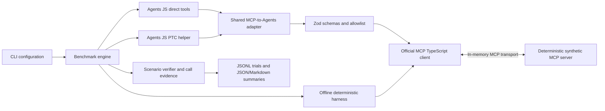

# MCP FlowBench

MCP FlowBench is a research-oriented benchmark harness for comparing direct tool calls with official Programmatic Tool Calling (PTC) in OpenAI Agents JS. Both live conditions use the same task, fixture data, MCP schemas, permissions, and scenario verifier, routed through a local MCP client adapter.

It targets a specific comparison gap: how do direct and programmatic invocation behave on controlled MCP-shaped tasks as tool catalogs and orchestration patterns change? This MVP checks correctness and records instrumentation; it makes no claim that either strategy is faster or cheaper.

## Architecture



Offline mode calls the deterministic harness directly through the MCP client and never executes an Agent or simulates PTC. Live direct mode calls Agents JS function tools; live PTC mode adds `programmaticToolCallingTool()` and restricts the same MCP-backed tools to the `programmatic` caller. Agents JS delegates generated programs to its supported execution boundary; FlowBench does not execute model-generated code in local Node.js. Both live strategies run against separate fixture instances created from the same fixed dataset. This is a local MCP-backed function-tool adapter benchmark, not a comparison with OpenAI's native hosted MCP tool or a remote MCP transport.

## What is actually measured

- **Offline mode** exercises the official MCP TypeScript SDK client/server protocol, shared schemas and permissions, scenarios, and verifiers. A deterministic harness selects calls. It makes no model request and reports no token estimates. Rows are marked `executionKind: offline-harness` and `benchmarkComparable: false`.
- **Live direct mode** runs a real model through OpenAI Agents JS with MCP-backed function tools restricted to `allowedCallers: ['direct']`.
- **Live programmatic mode** runs a real Responses model through Agents JS `programmaticToolCallingTool()` with those same tools restricted to `allowedCallers: ['programmatic']`. Program code runs in the provider-supported execution environment; FlowBench never evaluates it in local Node.js. A trial is comparable only when it actually invokes a tool.
- This is a **local MCP-client adapter** comparison. It does not benchmark native hosted `hostedMcpTool` or its network/service overhead. Both live strategies call the same synthetic in-memory MCP server through a client-owned adapter.

Live runs require an explicitly selected supported Responses model and `OPENAI_API_KEY`; they can incur API charges. The Agents JS run is aborted after 90 seconds. No live results are included yet.

## Install and verify

Requirements: Node.js 20 or later and pnpm 11.25.0 (the CI version).

```powershell
pnpm install --frozen-lockfile
pnpm format:check
pnpm lint
pnpm licenses:check
pnpm typecheck
pnpm test
pnpm build
```

## Offline harness

```powershell
pnpm run build
pnpm run flowbench -- --environment offline --strategy direct --scenario all --catalog-size 5,20,50,100 --trials 1 --output results
```

Offline mode rejects `--strategy programmatic`; it never pretends to run PTC. These runs validate the deterministic MCP harness, not model latency or token comparisons.

## Live Agents JS evaluations

```powershell
$env:OPENAI_API_KEY = "..."
pnpm run build
pnpm run flowbench -- --environment live --strategy direct --scenario dependent-calls --catalog-size 20 --trials 20 --model <supported-responses-model> --output results
pnpm run flowbench -- --environment live --strategy programmatic --scenario dependent-calls --catalog-size 20 --trials 20 --model <supported-responses-model> --output results
```

Use the same scenario, catalog size, model, and trial count for each strategy. Scenario task prompts, tool schemas, and server data are identical; the strategy instruction and `allowedCallers` differ by design to select direct versus genuine PTC execution. PTC trials that do not show scenario-specific successful MCP evidence are marked non-comparable. Outputs are separated under `results/live-direct` and `results/live-programmatic`; offline outputs go under `results/offline`. Median latency is always reported; p95 is omitted below 20 trials. Unavailable provider usage, retries, billable tokens, and peak memory remain null.

An opt-in six-trial smoke configuration is in `configs/live-smoke.json`. It covers single lookup, independent calls, and dependent calls in both strategies with five tools. The config is not executed automatically. It estimates $3.84 at GPT-6.2 Astra standard rates using an explicit assumption of 20k input and 4k output tokens per trial plus 2x headroom; actual charges can exceed that estimate, which is not an API spend cap. Obtain an approved spend limit before running. GPT-6.2 Astra is shown in the official PTC guide examples and currently listed at $8/M input and $40/M output standard pricing.

```powershell
pnpm run build
pnpm run flowbench -- --environment live --strategy direct --scenario single-lookup,independent-calls,dependent-calls --catalog-size 5 --trials 1 --model gpt-6.2-astra --output results
pnpm run flowbench -- --environment live --strategy programmatic --scenario single-lookup,independent-calls,dependent-calls --catalog-size 5 --trials 1 --model gpt-6.2-astra --output results
```

These commands make paid model requests when `OPENAI_API_KEY` is present. Review the assumptions and secure authorization first.

## Scenarios and limits

The synthetic catalog supports 5, 20, 50, and 100 tools across employee lookup, department retrieval, task search/pagination, report aggregation, and classroom queries. The ten scenarios cover single lookup, independent calls, dependent calls, catalog size, large responses, pagination, partial failure, concurrent discovery, cache invalidation, and permission denial.

Live results depend on model and prompt behavior. Offline mode is not a substitute for live evaluation. The fixture uses in-memory MCP transport; network transport and native hosted-MCP comparisons are outside this MVP. No benchmark performance claims are made until live runs are collected.

## Related work

- [OpenAI Agents JS Programmatic Tool Calling](https://developers.openai.com/api/docs/guides/tools-programmatic-tool-calling) provides the live PTC mechanism evaluated here; the offline harness does not imitate it.
- [Cloudflare Code Mode](https://developers.cloudflare.com/agent-setup/command-code/) exposes API operations through code-oriented search/execute tools and a sandboxed runtime. It is a related design direction, but is not implemented or measured by this project.
- [MCPMark](https://github.com/eval-sys/mcpmark) and [MCP-Atlas](https://github.com/scaleapi/mcp-atlas) evaluate broader tasks against realistic MCP environments and servers. FlowBench's synthetic fixture is smaller and designed for controlled paired comparisons.
- [PTC-Bench](https://arxiv.org/abs/2611.01446) studies long-horizon programmatic tool use. FlowBench currently covers short, deterministic scenario families and does not reproduce that evaluation scope.

These projects answer different research questions. FlowBench does not claim to be first, comprehensive, or superior to them.

## Security and data handling

Ordinary benchmark runs use fixed synthetic data. Set `OPENAI_API_KEY` in the process environment as shown in the live examples; the CLI does not load `.env` files, though Git ignores them if you use one with an explicit loader. Never place credentials in result files, prompts, source, or support requests. Live results record synthetic tool arguments and outputs in JSONL. Review artifacts before sharing, even though the included fixture contains no customer records. Programmatic code runs only through the Agents SDK's supported hosted environment; arbitrary local Node.js code execution is not part of this project.

## License

MCP FlowBench is distributed under the MIT License; see [LICENSE](LICENSE).
